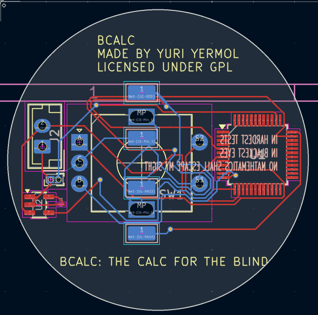
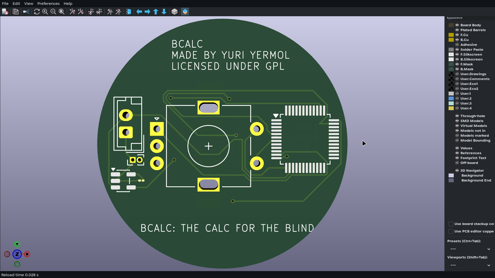

# BCALC
A calculator designed specifically for people with visual impairment, fully FOSS so anybody can make it.
# THIS PROJECT DOES NOT CURRENTLY HAVE FIRMWARE AND IS A WIP. IF SOMEBODY WANTS TO HELP WITH IT, PLEASE HELP ME I SUCK AT C++
## What is this, anyway?
BCalc is a calculator meant for people who have difficulty seeing. it uses a rotary encoder for input and vibration combined with Morse code for output.

